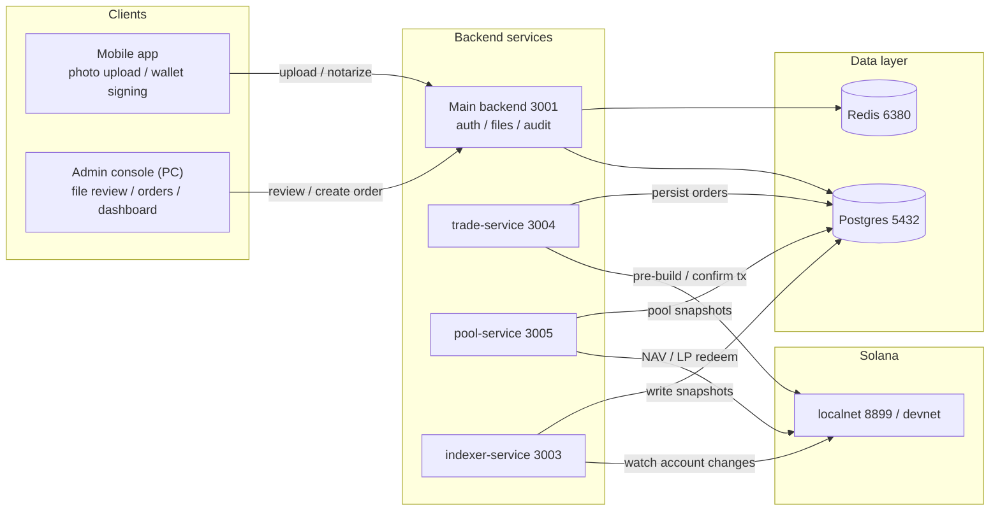

<div align="center">

# ⛓️ Blockchain Supply Chain Monorepo

**Solana/Anchor supply-chain finance platform** · Document review · On-chain notarization · Trade orders · Liquidity pool


</div>

---

A supply-chain finance platform built on **Solana/Anchor**, covering the full flow **document upload and review → on-chain notarization → trade orders → liquidity pool**. Managed with `pnpm workspaces + Turbo`.

## ✨ Features

- 🔗 **On-chain notarization** — document hashes are written on-chain: tamper-evident and auditable
- 📋 **Document review** — admin review, file management, permissioned registration
- 💱 **Trade orders** — full lifecycle: create → pre-build → on-chain confirmation
- 💰 **Liquidity pool** — LP deposit/redeem, NAV snapshots, on-chain account listener write-back
- 🛡 **Permission model** — three-tier roles (USER / ADMIN / SUPER_ADMIN)
- 🔐 **Security audit** — independent audit report; 1 Critical + 6 High findings all fixed and re-tested

## 📦 Packages

- `packages/contracts`: Anchor 0.31.1 programs (`trade-finance` full lifecycle + `supply-chain`),
  toolchain Agave 4.1.2 + SBFv3. `supply-chain` uses permissioned registration: the admin (Registry) can
  grant/revoke suppliers, and only the admin or an authorized supplier can register products. The main
  backend is wired to the supply-chain management API, and the frontend "Supply Chain Management" page
  supports wallet signing for initialize/authorize/register (see `docs/API.md`).
- `packages/backend`: NestJS 11 main backend (auth, files, notarization) plus 3 standalone services:
  `indexer-service` (on-chain listening and DB write-back), `trade-service` (order pre-build and
  confirmation), `pool-service` (pool overview and LP withdrawal).
- `packages/frontend`: Next.js 15 App Router + Tailwind + shadcn/ui + Solana wallet.
  Supports Phantom / Backpack / Solflare / Coinbase Wallet / UnsolvedBloom.

## 🏗 Architecture



## 🚀 Local setup

```bash
./init-monorepo.sh --infra
cd packages/backend && pnpm exec prisma generate && pnpm exec prisma migrate deploy
```

Infrastructure (Postgres / Redis / Solana localnet):

```bash
docker compose up -d
```

The first run of `solana-localnet` builds the Agave 4.1.2 image (pinned to `linux/amd64`,
emulated by Docker on Apple Silicon), so make sure GitHub Releases is reachable during the build.

Build and deploy the programs to localnet:

```bash
cd packages/contracts
anchor build
cargo build-sbf --arch v3
PATH="$HOME/.local/share/solana/active_release/bin:$PATH" solana program deploy \
  target/deploy/trade_finance.so --program-id target/deploy/trade_finance-keypair.json
PATH="$HOME/.local/share/solana/active_release/bin:$PATH" solana program deploy \
  target/deploy/supply_chain.so --program-id target/deploy/supply_chain-keypair.json
```

Backend services (default ports):

```bash
cd packages/backend
pnpm dev              # main backend 3001
pnpm dev:indexer      # 3003 (requires REDIS_URL=redis://localhost:6380)
pnpm dev:trade        # 3004
pnpm dev:pool         # 3005 (requires REDIS_URL=redis://localhost:6380)
```

Start every local service at once (the validator must already be running via `docker compose up -d`;
run `node scripts/init-localnet.mjs | tee infra/config/localnet.env` first):

```bash
bash scripts/dev-all.sh
```

Frontend:

```bash
cd packages/frontend
FRONTEND_PORT=3100 pnpm dev
```

Open `http://localhost:3100`. Seed accounts (rebuild with `pnpm --filter @supply-chain/backend prisma:seed`):

| Role | Email | Password |
| --- | --- | --- |
| Super admin | `root@supply-chain.io` | `SuperAdmin123!` |
| Admin | `admin@supply-chain.io` | `Admin123!` |

There are three role tiers: user (USER) / admin (ADMIN) / super admin (SUPER_ADMIN).
Admins can access all review and management pages; super admins additionally own
**Account management** (view all accounts and their content, add admins, change account types).

One-shot health check (backend, RPC, frontend):

```bash
bash scripts/health-check.sh
```

## 🧪 Testing

```bash
pnpm --filter @supply-chain/backend exec jest --runInBand
cd packages/contracts && pnpm test
cd packages/frontend && pnpm build
```

The program tests (`pnpm test` in `packages/contracts`) manage an isolated
`solana-test-validator` automatically: it picks a random free port (never 8899 or other dev ports),
builds and deploys both programs with `cargo build-sbf --arch v3` (SBFv3/eBPF, required by Agave 4.1.2),
then cleans up the ledger and validator processes when done.

CI notes: the `changes` job filters by path up front; backend/frontend/security-audit jobs can run on
a local self-hosted runner (`codex-mac`, macOS ARM64, not billed), while program/e2e/monitoring/
backup jobs use GitHub-hosted runners. Secret scanning is performed by `scripts/scan-secrets.sh`
(worktree + Git history) and fails on any suspected credential.

## 🚢 Deployment

See [docs/DEPLOYMENT.md](docs/DEPLOYMENT.md) for Kubernetes deployment and image builds, and
[docs/LAUNCH-CHECKLIST.md](docs/LAUNCH-CHECKLIST.md) for the pre-launch checklist.

## 📚 Documentation

- [Local demo guide](docs/DEMO.md): local accounts, flows, and reset
- [Deployment guide](docs/DEPLOYMENT.md) (Chinese) / [DEPLOYMENT.en.md](docs/DEPLOYMENT.en.md) (English)
- [Operations guide](docs/OPERATIONS.md) (Chinese) / [OPERATIONS.en.md](docs/OPERATIONS.en.md) (English)
- [Video script](docs/VIDEO-SCRIPT.md): 8 shots with Chinese/English narration and screen-recording tips
- [API reference](docs/API.md): all endpoints for auth, files, orders, pool, and indexer
- [Go-live runbook](docs/GO-LIVE-RUNBOOK.md) and
  [launch checklist](docs/LAUNCH-CHECKLIST.md)
- [Phase 2 cloud checklist](docs/PHASE2-CLOUD-CHECKLIST.md): resources and timeline required before a real launch
- [devnet → mainnet migration checklist](docs/MAINNET-MIGRATION.md): on-chain rebuild, config swap, test rerun at launch
- [Audit economic model](docs/AUDIT-ECONOMIC-MODEL.md) and [known risks](docs/AUDIT-KNOWN-RISKS.md): third-party audit material
- [Privacy/terms template](docs/PRIVACY-TERMS-TEMPLATE.md) and [on-call SOP](docs/ONCALL-SOP.md)
- [Audit delivery checklist and quote template](docs/AUDIT-DELIVERY.md)
- [Technical cost estimate](docs/COSTS.md) (audit not included)
- [Incident runbook](docs/INCIDENT-RUNBOOK.md)
- [Audit report](docs/AUDIT-REPORT.md),
  [load test report](docs/LOAD-TEST-REPORT.md), and [NEST-11-UPGRADE.md](docs/NEST-11-UPGRADE.md)
